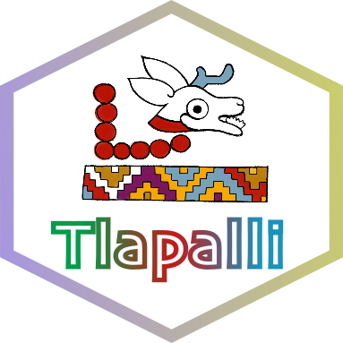
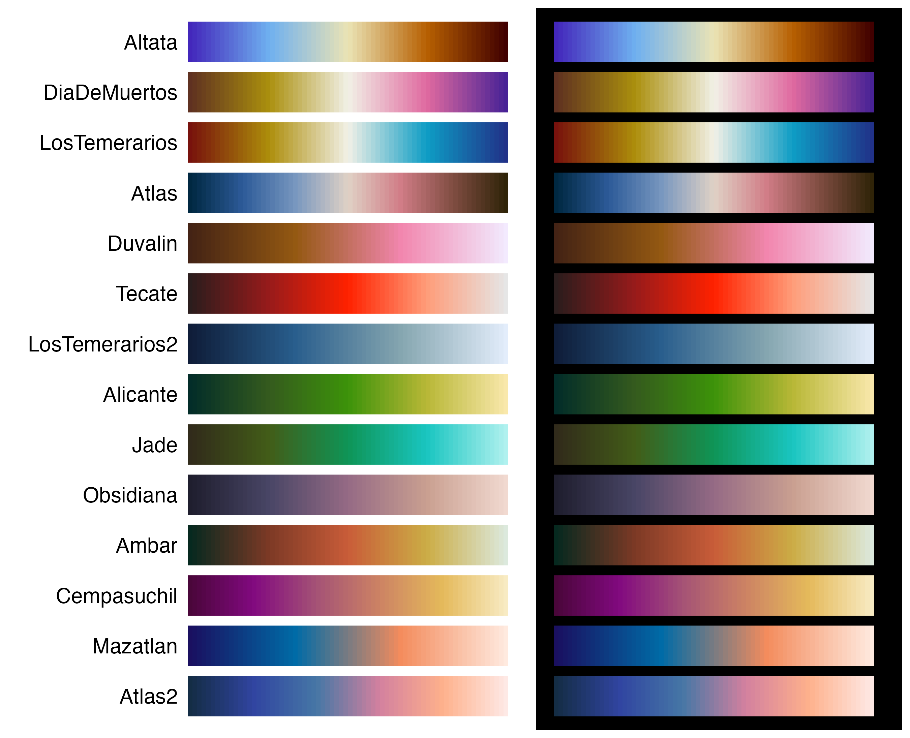
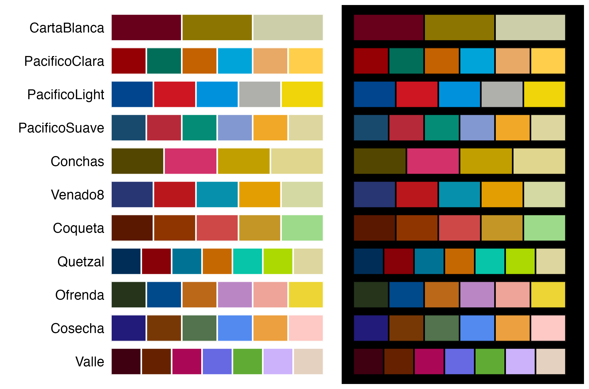

---
output:
  github_document:
    html_preview: false
---

```{r setup, include=FALSE}
knitr::opts_chunk$set(
  collapse = TRUE,
  comment = "#>",
  fig.path = "man/figures/README-",
  out.width = "400px"
)

knitr::knit_hooks$set(plot = function(x, options) {
  w   <- sub("px$", "", options$out.width)
  alt <- if (is.null(options$fig.alt)) "" else options$fig.alt
  sprintf('\n<p align="center">\n  \n</p>\n',
          x, w, alt)
})
```


<h1 align="center"><strong>&#123; Tlapalli &#125;</strong></h1>

<h4 align="center"><em>In tlilli, in tlapalli</em></h4>

Disponible en: [](https://github.com/mariameraz/tlapalli/blob/main/README_ES.md)

<br>



<p align="justify">
<br>
R color palettes inspired by elements of Mexican and Mesoamerican culture. All palettes were designed with different ways of perceiving color in mind. This is a small personal project, so for now it is only available to install from GitHub. The package currently has 27 palettes, available as both discrete and continuous scales, and I hope be adding more over time. Suggestions are welcome and appreciated (҂◡_◡) ᕤ !
</p>

<br clear="left">

## Installation

``` {r, eval=FALSE}
install.packages(c("remotes"))
remotes::install_github("mariameraz/tlapalli")
```

# Palettes

## ☆ Continuous

<p align="center">
  
</p>

## ☆ Discrete

<p align="center">
  
</p>

## Example

Basic examples of how to use our color palettes:

```{r}
library(tlapalli)
library(ggplot2)

# List available palettes
names(tlapalli)

# Get the colors of a palette
tlapalli_pal("Ambar")

# Interpolate colors to get a palette with 10 colors
tlapalli_pal("Ambar", n = 10, type = "continuous")

```

```{r example5, fig.align="center", out.width="400px"}
# Show color palettes
tlapalli_show("Venado8", background = "black")
```

```{r example6, fig.align="center", out.width="400px"}
tlapalli_show("Altata", n = 100, type = "continuous", background = "both")
```

```{r example1, fig.align="center", out.width="400px"}
# Continuous scale in ggplot2
ggplot(faithfuld, aes(waiting, eruptions, fill = density)) +
   geom_tile() +
   scale_fill_tlapalli_c("Azulillo") +
   theme_minimal()
```


```{r example2, fig.align="center", out.width="400px"}
# Discrete scale in ggplot2
ggplot(mpg, aes(class, fill = class)) +
  geom_bar() +
  scale_fill_tlapalli_d("Quetzal") +
  theme_bw()
```


```{r example3, fig.align="center", out.width="400px"}
# Discrete palette in base R
barplot(1:6, col = tlapalli_pal("PacificoSuave"))
```

```{r example4, fig.align="center", out.width="400px"}
# Continuous palette in base R
image(volcano, col = tlapalli_pal("Ambar", n = 100, type = "continuous"))
```
