<h1 align="center">Tlapalli</h1>
<p align="center"><em>In tlilli, in tlapalli</em></p>

<table>
  <tr>
    <td width="66%" valign="middle">

Blind safe color palettes for R. Each palette is inspired by elements of Mexican and Mesoamerican culture. This is a small personal project, so for now it is only available to install from GitHub. The package currently has 32 palettes, but we'll be adding more over time. Suggestions are welcome and appreciated!

</td>
    <td width="33%" align="center" valign="middle">
      
    </td>
  </tr>
</table>


## Installation

You can install the development version of tlapalli like so:

``` r
# Install package from GitHub
install.packages(c("remotes"))
remotes::install_github("mariameraz/tlapalli")
```

## Example

Basic example of how to use the color palettes:

``` r
library(tlapalli)
library(ggplot2)

# Get the colors of a palette
ambar_pal <- tlapalli_pal("Ambar")

# Or use it in a plot

ggplot(faithfuld, aes(waiting, eruptions, fill = density)) +
  geom_raster() +
  scale_fill_tlapalli_c("Ambar")
  
barplot(1:5, col = tlapalli_pal("Ambar", n = 5))

image(volcano, col = tlapalli_pal("Jade", n = 100, type = "continuous"))  
```

# Palettes

<p align="center">
  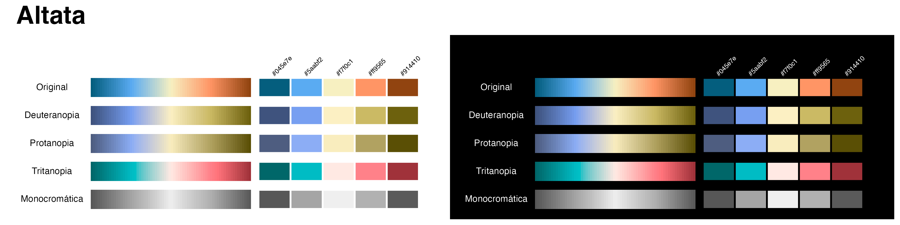
</p>

<p align="center">
  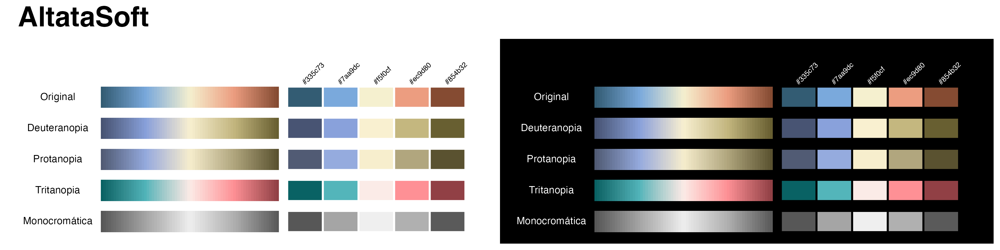
</p>

<p align="center">
  
</p>

<p align="center">
  <sub>Photo: Miguel Angel Victoria / Sinaloa 360</sub>
</p>

<br>

-----

<br>

<p align="center">
  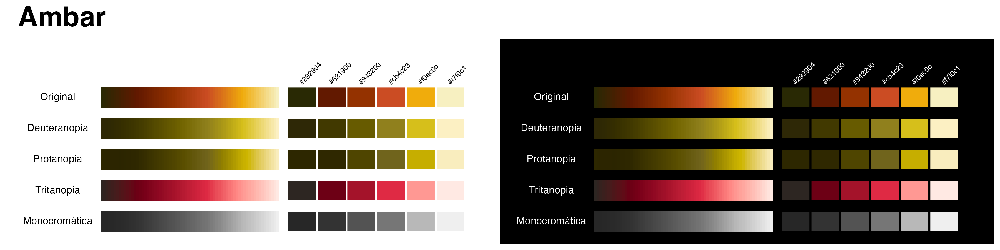
</p>

<p align="center">
  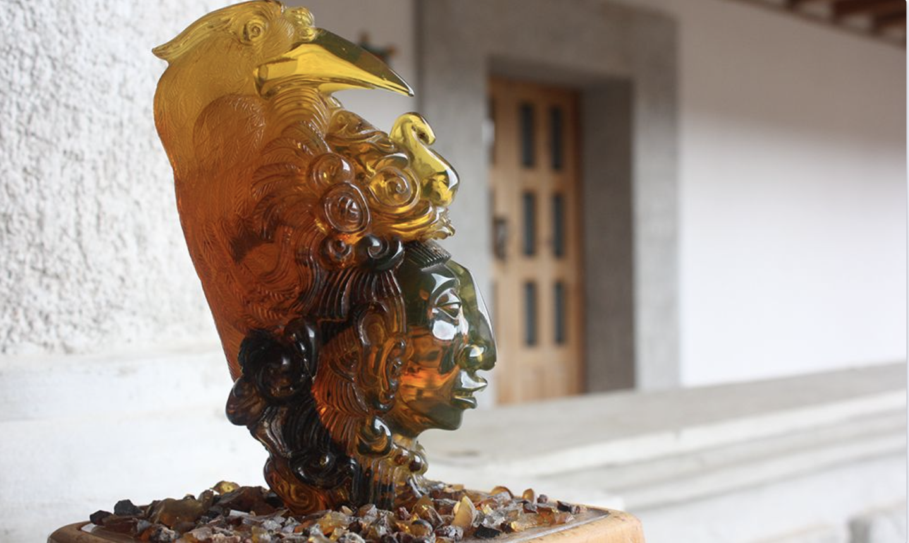
</p>

<p align="center">
  <sub>Photo: <a href="https://mr.travelbymexico.com/5062-museo-del-ambar/">Travel By México / México Real</a></sub>
</p>

<br>

-----

<br>

<p align="center">
  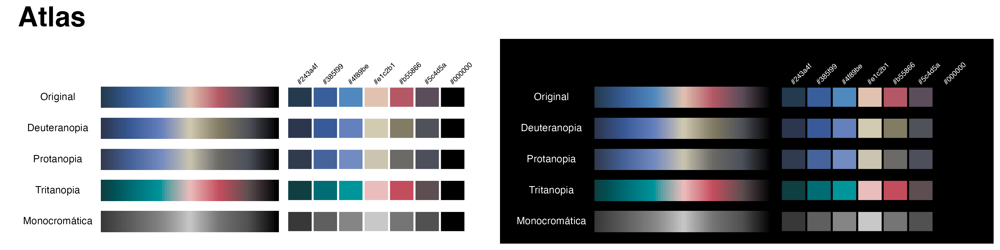
</p>

<p align="center">
  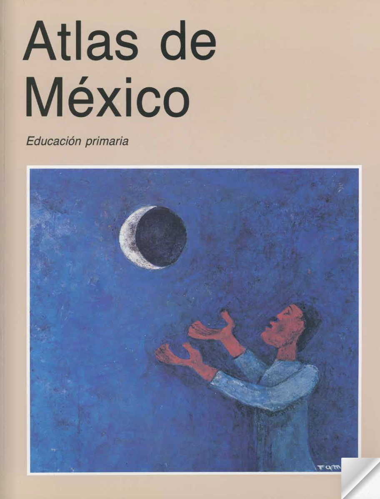
</p>

<p align="center">
  <sub>Source: SEP, <a href="https://historico.conaliteg.gob.mx/H1993P4GE197.htm"><i>Atlas de México</i>, 4.º grado (Conaliteg, 1993)</a></sub>
</p>

<br>

-----

<br>

<p align="center">
  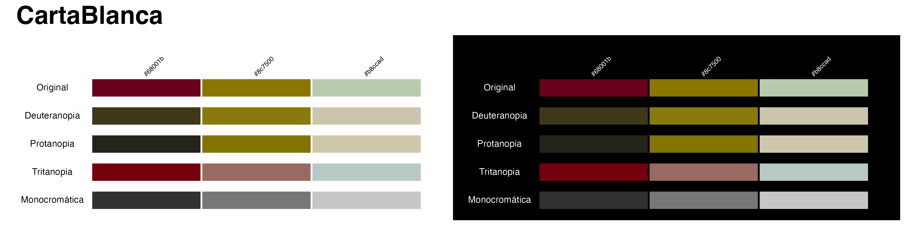
</p>

<p align="center">
  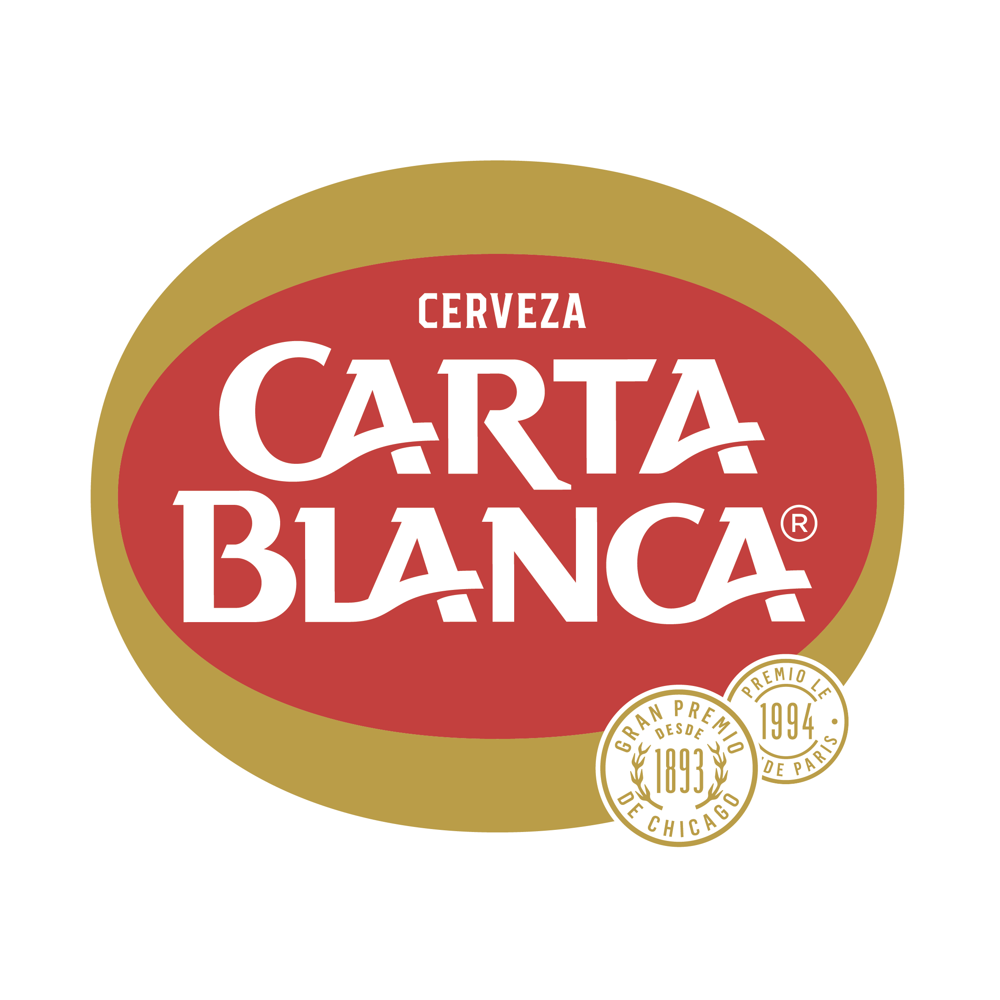
</p>

<p align="center">
  <sub>Source: <a href="https://www.cartablanca.com.mx/agegate/?redirect=%2F"><i>Cervecería Carta Blanca</i></a></sub>
</p>

<br>

-----

<br>

<p align="center">
  
</p>

<br>

-----

<br>

<p align="center">
  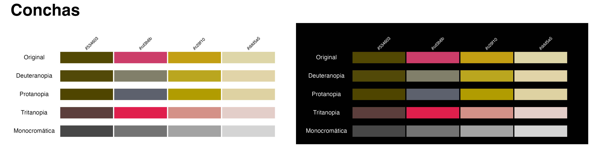
</p>

<br>

-----

<br>

<p align="center">
  
</p>

<br>

-----

<br>

<p align="center">
  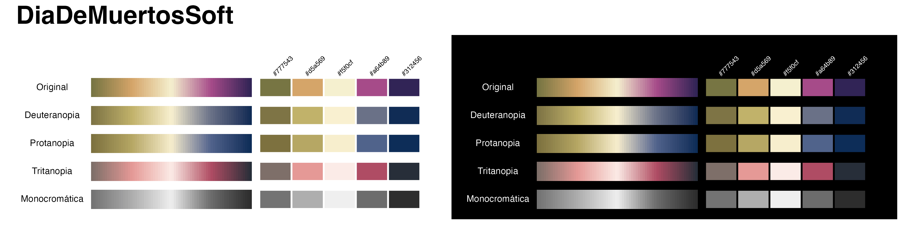
</p>

<br>

-----

<br>

<p align="center">
  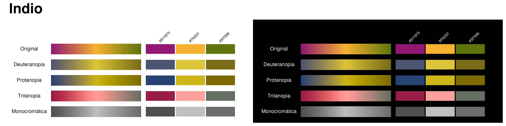
</p>

<br>

-----

<br>

<p align="center">
  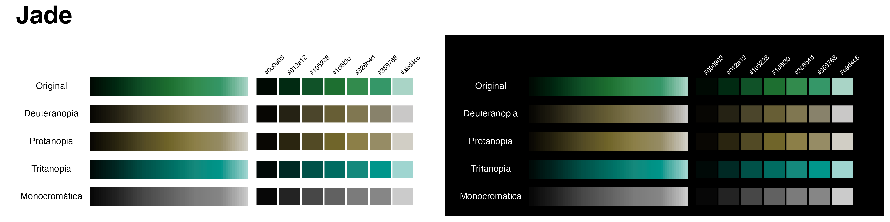
</p>

<br>

-----

<br>

<p align="center">
  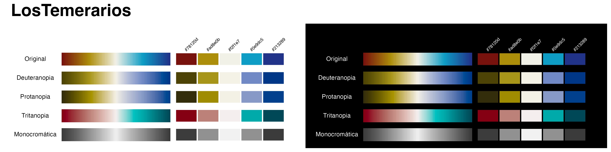
</p>

<br>

-----

<br>

<p align="center">
  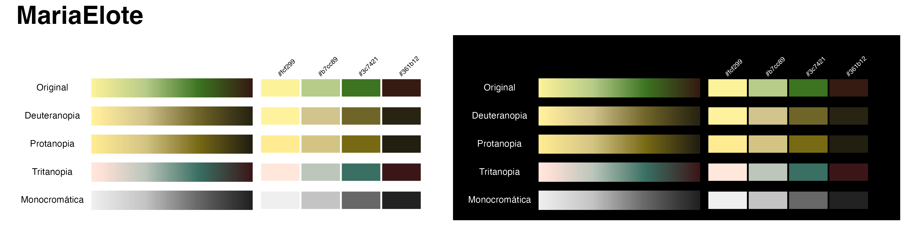
</p>

<br>

-----

<br>

<p align="center">
  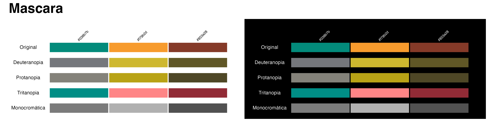
</p>

<br>

-----

<br>

<p align="center">
  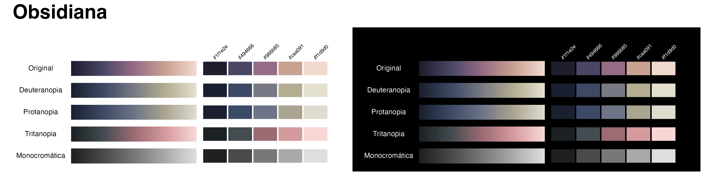
</p>

<br>

-----

<br>

<p align="center">
  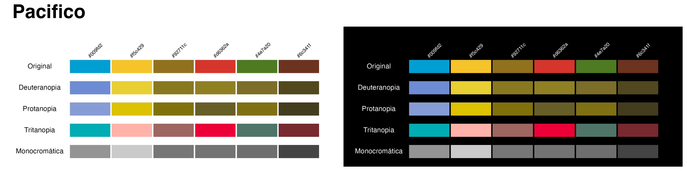
</p>

<br>

-----

<br>

<p align="center">
  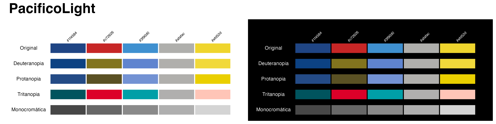
</p>

<br>

-----

<br>

<p align="center">
  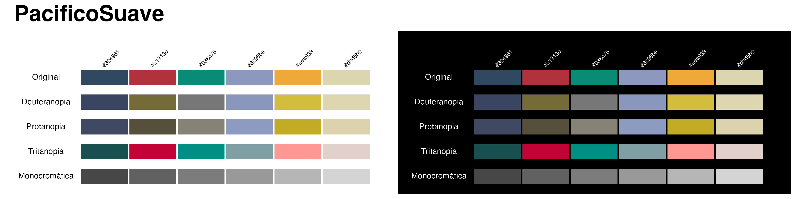
</p>

<br>

-----

<br>

<p align="center">
  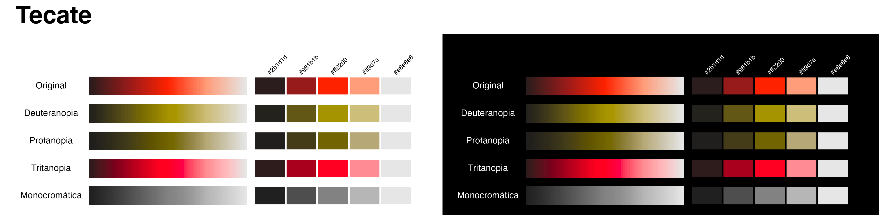
</p>

<br>

-----

<br>

<p align="center">
  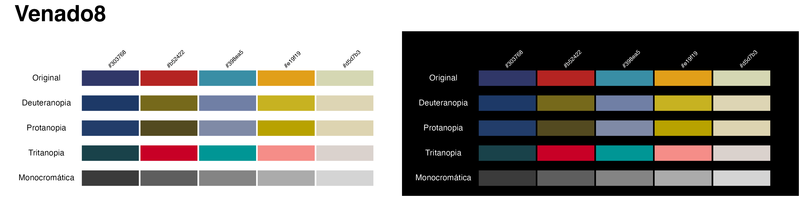
</p>

<br>

-----

<br>

<p align="center">
  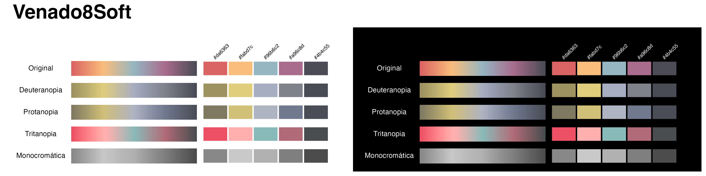
</p>
