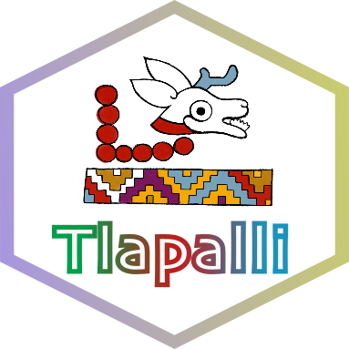
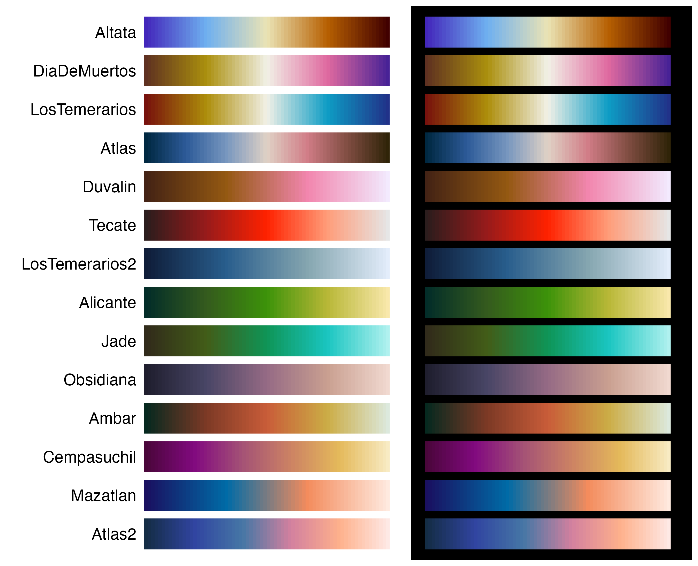
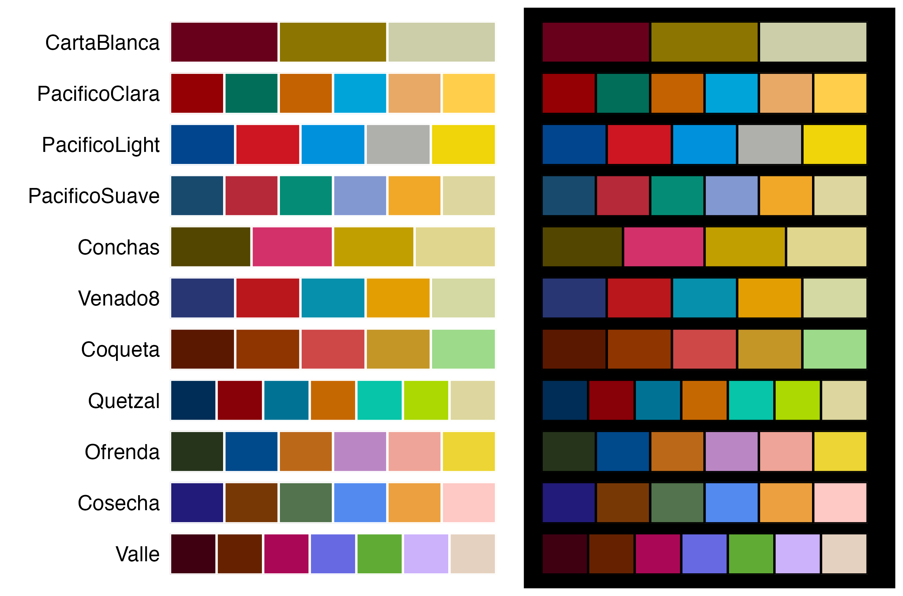
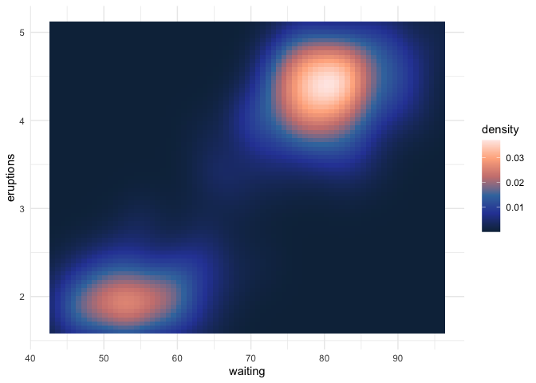
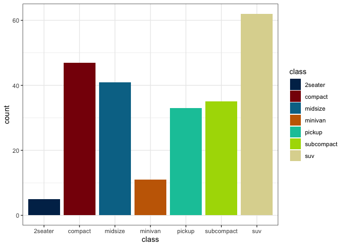
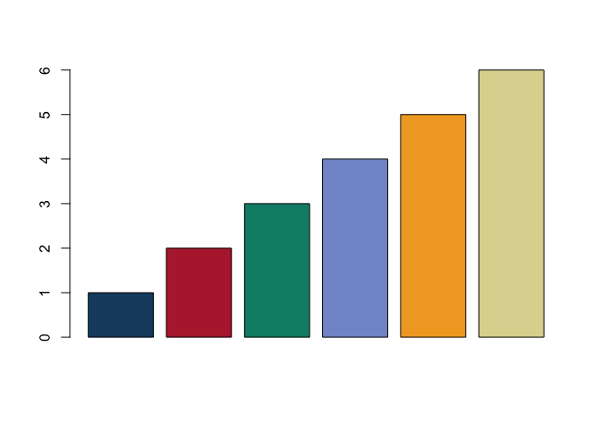
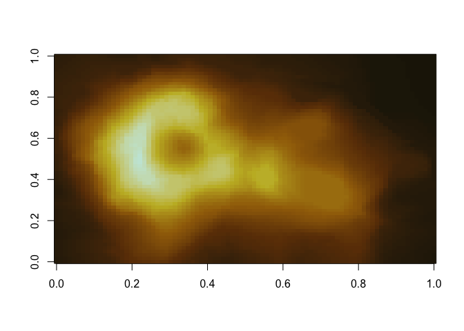
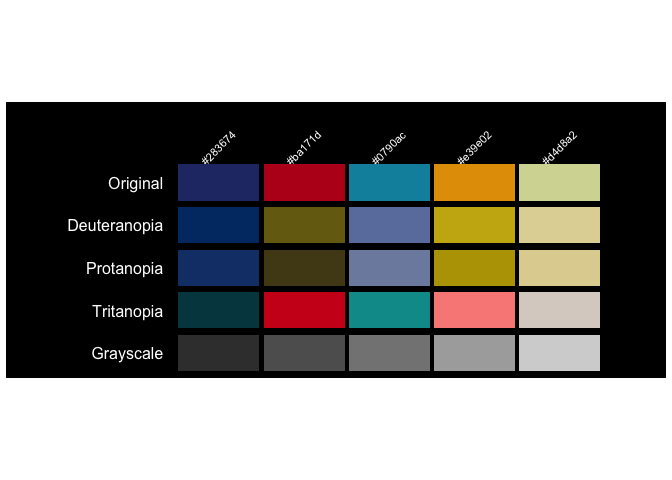
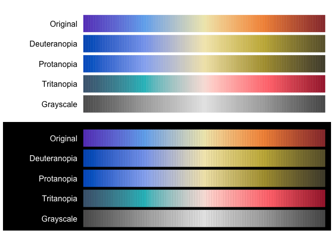

<h1 align="center">

<strong>{ Tlapalli }</strong>
</h1>

<p align="center">

<em>In tlilli, in tlapalli</em>
</p>

Disponible en:
[](https://github.com/mariameraz/tlapalli/blob/main/README_ES.md)

<br>



<p align="justify">

<br> R color palettes inspired by elements of Mexican and Mesoamerican
culture. All palettes were designed with different ways of perceiving
color in mind. This is a small personal project, so for now it is only
available to install from GitHub. The package currently has 27 palettes,
available as both discrete and continuous scales, and I hope be adding
more over time. Suggestions are welcome and appreciated (҂◡\_◡) ᕤ !
</p>

<br clear="left">

## Installation

``` r
install.packages(c("remotes"))
remotes::install_github("mariameraz/tlapalli")
```

# Palettes

## ☆ Continuous

<p align="center">


</p>

## ☆ Discrete

<p align="center">


</p>

## Example

Basic examples of how to use our color palettes:

``` r
library(tlapalli)
library(ggplot2)

# List available palettes
names(tlapalli)
#>  [1] "Altata"         "DiaDeMuertos"   "LosTemerarios"  "Atlas"         
#>  [5] "Duvalin"        "Tecate"         "LosTemerarios2" "Alicante"      
#>  [9] "Jade"           "Obsidiana"      "Ambar"          "Cempasuchil"   
#> [13] "Mazatlan"       "Atlas2"         "CartaBlanca"    "PacificoClara" 
#> [17] "PacificoLight"  "PacificoSuave"  "Conchas"        "Venado8"       
#> [21] "Coqueta"        "Quetzal"        "Ofrenda"        "Cosecha"       
#> [25] "Valle"

# Get the colors of a palette
tlapalli_pal("Ambar")
#> [1] "#06291f" "#7d3a26" "#c95d39" "#ccad46" "#dce9dd"

# Interpolate colors to get a palette with 10 colors
tlapalli_pal("Ambar", n = 10, type = "continuous")
#>  [1] "#06281F" "#413322" "#703925" "#95452C" "#B75434" "#CA703B" "#CC9341"
#>  [8] "#CFB357" "#D9CD9A" "#DCE9DD"
```

``` r
# Continuous scale in ggplot2
ggplot(faithfuld, aes(waiting, eruptions, fill = density)) +
   geom_tile() +
   scale_fill_tlapalli_c("Atlas2") +
   theme_minimal()
```

<p align="center">


</p>

``` r
# Discrete scale in ggplot2
ggplot(mpg, aes(class, fill = class)) +
  geom_bar() +
  scale_fill_tlapalli_d("Quetzal") +
  theme_bw()
```

<p align="center">


</p>

``` r
# Discrete palette in base R
barplot(1:6, col = tlapalli_pal("PacificoSuave"))
```

<p align="center">


</p>

``` r
# Continuous palette in base R
image(volcano, col = tlapalli_pal("Ambar", n = 100, type = "continuous"))
```

<p align="center">


</p>

``` r
# Show color palettes
tlapalli_show("Venado8", background = "black")
```

<p align="center">


</p>

``` r
tlapalli_show("Altata", n = 100, type = "continuous", background = "both")
```

<p align="center">


</p>
