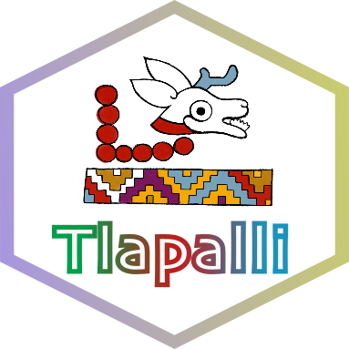
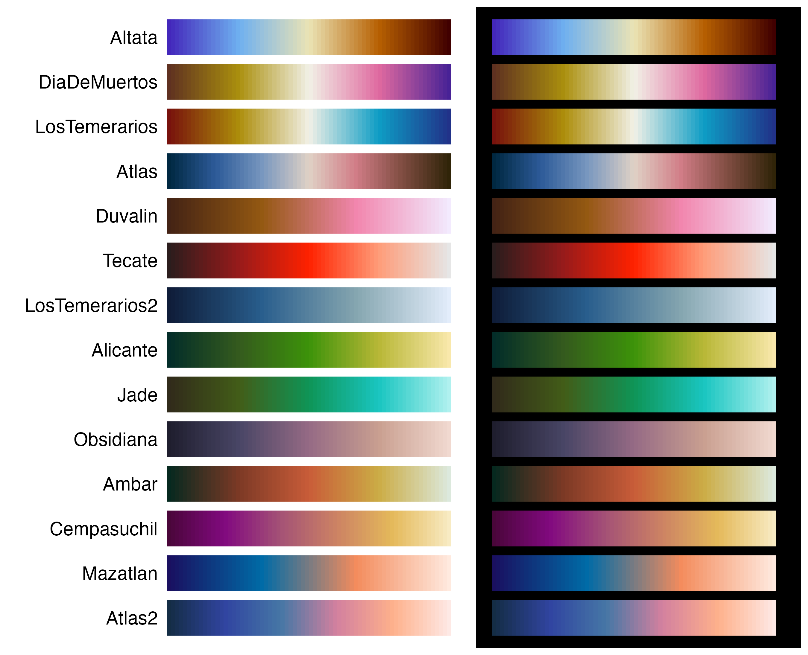
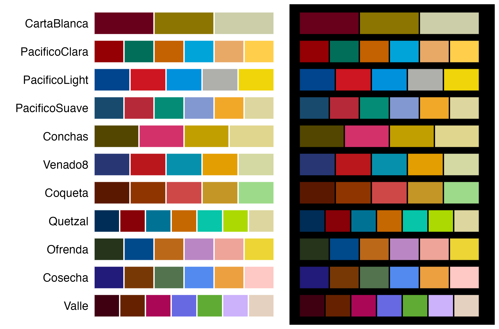

---
output:
  github_document:
    html_preview: false
---

```{r setup, include=FALSE}
knitr::opts_chunk$set(
  collapse = TRUE,
  comment = "#>",
  fig.path = "man/figures/README-",
  out.width = "400px"
)

knitr::knit_hooks$set(plot = function(x, options) {
  w   <- sub("px$", "", options$out.width)
  alt <- if (is.null(options$fig.alt)) "" else options$fig.alt
  sprintf('\n<p align="center">\n  \n</p>\n',
          x, w, alt)
})
```

<h1 align="center"><strong>&#123; Tlapalli &#125;</strong></h1>

<p align="center"><em>In tlilli, in tlapalli</em> </p>

Available in: [](https://github.com/mariameraz/tlapalli/blob/main/README.md)

<br>



<p align="justify">
<br>
Paletas de colores para R inspiradas en elementos de la cultura mexicana y mesoamericana. Todas fueron creadas considerando distintas formas de percibir el color. Es un proyecto personal y pequeño, así que por ahora solo se instala desde GitHub. Actualmente incluye 27 paletas, disponibles tanto en escalas discretas como continuas, y espero seguir añadiendo más. ¡Cualquier sugerencia es bienvenida (҂◡_◡) ᕤ !
</p>

<br clear="left">

## Instalación

``` {r, eval=FALSE}
install.packages(c("remotes"))
remotes::install_github("mariameraz/tlapalli")
```

# Paletas

## ☆ Continuas

<p align="center">
  
</p>

## ☆ Discretas

<p align="center">
  
</p>

## Ejemplos

Ejemplos básicos de ocmo usar nuestras paletas de colores:

```{r}
library(tlapalli)
library(ggplot2)

# Ver las paletas disponibles
names(tlapalli)

# Obtener los colores de una paleta
tlapalli_pal("Ambar")

# Interpolar colores para obtener una paleta de 10 colores
tlapalli_pal("Ambar", n = 10, type = "continuous")
```


```{r example1, fig.align="center", out.width="400px"}
# Escala continua en ggplot2
ggplot(faithfuld, aes(waiting, eruptions, fill = density)) +
   geom_tile() +
   scale_fill_tlapalli_c("Atlas2") +
   theme_minimal()
```


```{r example2, fig.align="center", out.width="400px"}
# Escala discreta en ggplot2
ggplot(mpg, aes(class, fill = class)) +
  geom_bar() +
  scale_fill_tlapalli_d("Quetzal") +
  theme_bw()
```


```{r example3, fig.align="center", out.width="400px"}
# Paleta discreta en R base
barplot(1:6, col = tlapalli_pal("PacificoSuave"))
```


```{r example4, fig.align="center", out.width="400px"}
# Paleta continua en R base
image(volcano, col = tlapalli_pal("Ambar", n = 100, type = "continuous"))
```


```{r example5, fig.align="center", out.width="400px"}
# Mostrar paletas de colores en fondo negro
tlapalli_show("Venado8", background = "black")
```


```{r example6, fig.align="center", out.width="400px"}
tlapalli_show("Altata", n = 100, type = "continuous", background = "both")
```

