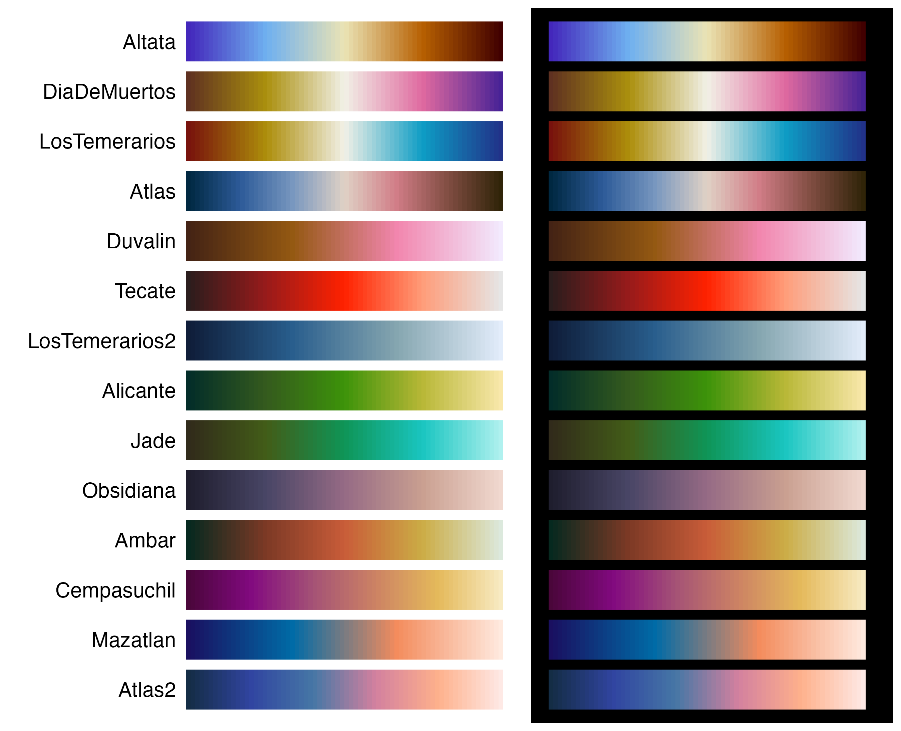
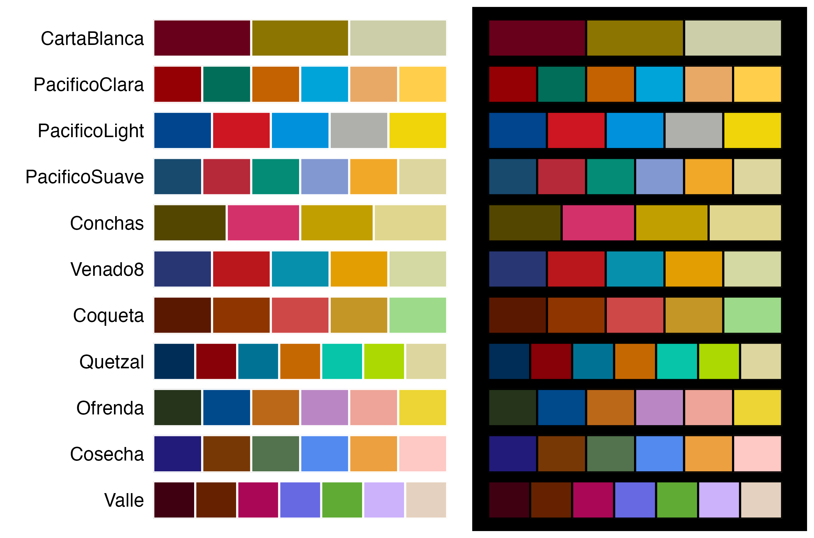
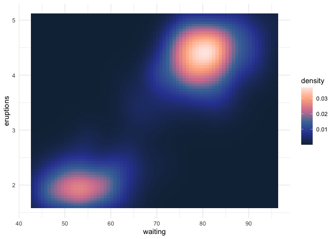
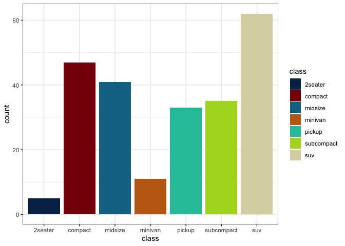
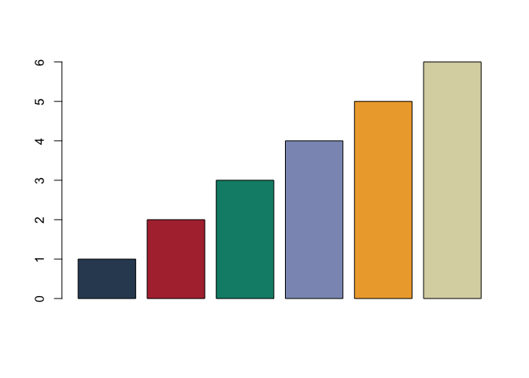
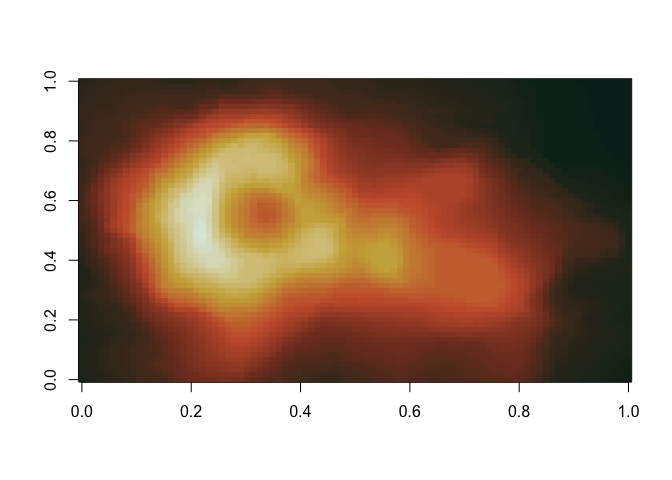
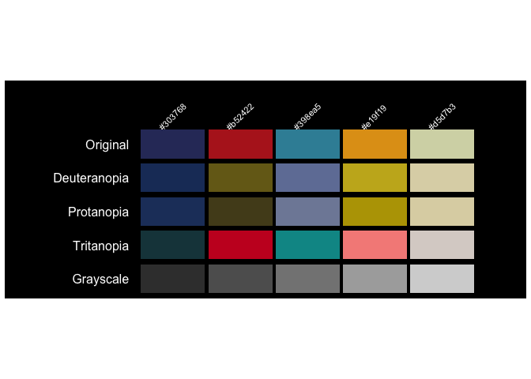
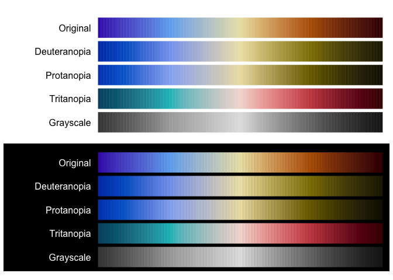

# { Tlapalli }

*In tlilli, in tlapalli*

Available in:
[](https://github.com/mariameraz/tlapalli/blob/main/README.md)

  


  
Paletas de colores para R inspiradas en elementos de la cultura mexicana
y mesoamericana. Todas fueron creadas considerando distintas formas de
percibir el color. Es un proyecto personal y pequeño, así que por ahora
solo se instala desde GitHub. Actualmente incluye 27 paletas,
disponibles tanto en escalas discretas como continuas, y espero seguir
añadiendo más. ¡Cualquier sugerencia es bienvenida (҂◡\_◡) ᕤ !

  

## Instalación

``` r

install.packages(c("remotes"))
remotes::install_github("mariameraz/tlapalli")
```

# Paletas

## ☆ Continuas



## ☆ Discretas



## Ejemplos

Ejemplos básicos de ocmo usar nuestras paletas de colores:

``` r

library(tlapalli)
library(ggplot2)

# Ver las paletas disponibles
names(tlapalli)
#>  [1] "Altata"         "DiaDeMuertos"   "LosTemerarios"  "Atlas"         
#>  [5] "Duvalin"        "Tecate"         "LosTemerarios2" "Alicante"      
#>  [9] "Jade"           "Obsidiana"      "Ambar"          "Cempasuchil"   
#> [13] "Mazatlan"       "Atlas2"         "CartaBlanca"    "PacificoClara" 
#> [17] "PacificoLight"  "PacificoSuave"  "Conchas"        "Venado8"       
#> [21] "Coqueta"        "Quetzal"        "Ofrenda"        "Cosecha"       
#> [25] "Valle"

# Obtener los colores de una paleta
tlapalli_pal("Ambar")
#> [1] "#06291f" "#7d3a26" "#c95d39" "#ccad46" "#dce9dd"

# Interpolar colores para obtener una paleta de 10 colores
tlapalli_pal("Ambar", n = 10, type = "continuous")
#>  [1] "#06281F" "#413322" "#703925" "#95452C" "#B75434" "#CA703B" "#CC9341"
#>  [8] "#CFB357" "#D9CD9A" "#DCE9DD"
```

``` r

# Escala continua en ggplot2
ggplot(faithfuld, aes(waiting, eruptions, fill = density)) +
   geom_tile() +
   scale_fill_tlapalli_c("Atlas2") +
   theme_minimal()
```



``` r

# Escala discreta en ggplot2
ggplot(mpg, aes(class, fill = class)) +
  geom_bar() +
  scale_fill_tlapalli_d("Quetzal") +
  theme_bw()
```



``` r

# Paleta discreta en R base
barplot(1:6, col = tlapalli_pal("PacificoSuave"))
```



``` r

# Paleta continua en R base
image(volcano, col = tlapalli_pal("Ambar", n = 100, type = "continuous"))
```



``` r

# Mostrar paletas de colores en fondo negro
tlapalli_show("Venado8", background = "black")
```



``` r

tlapalli_show("Altata", n = 100, type = "continuous", background = "both")
```


