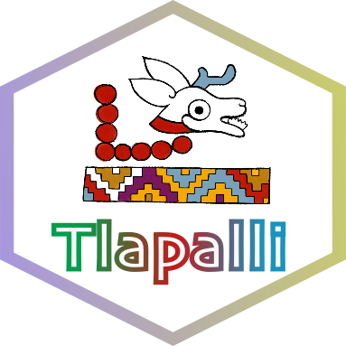
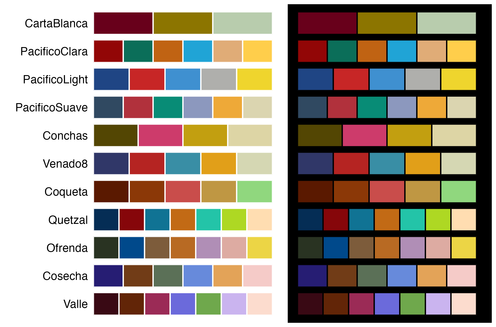
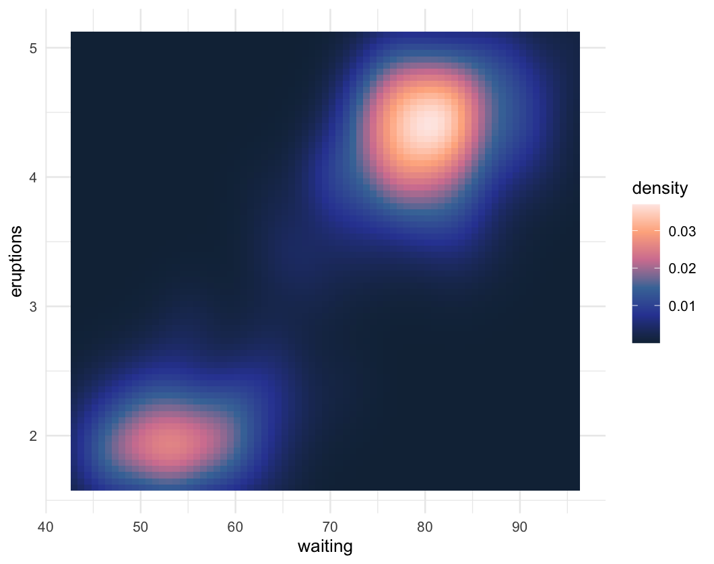
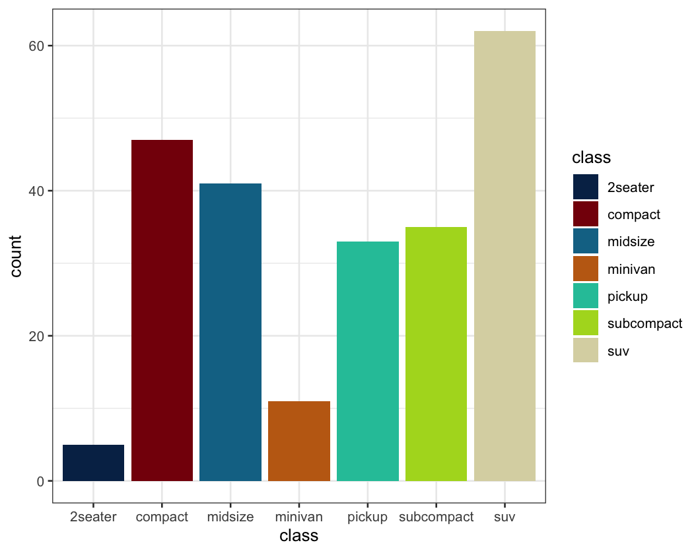
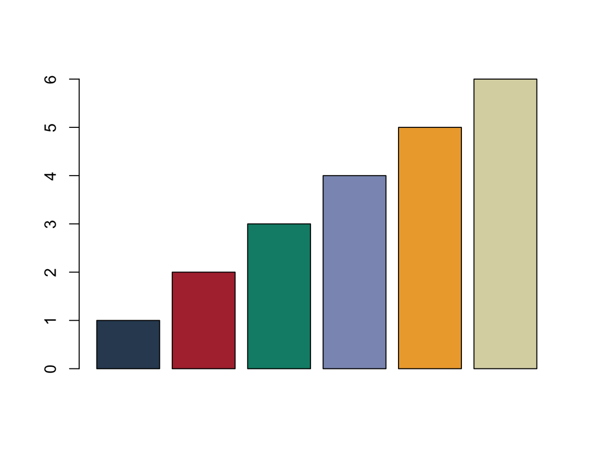
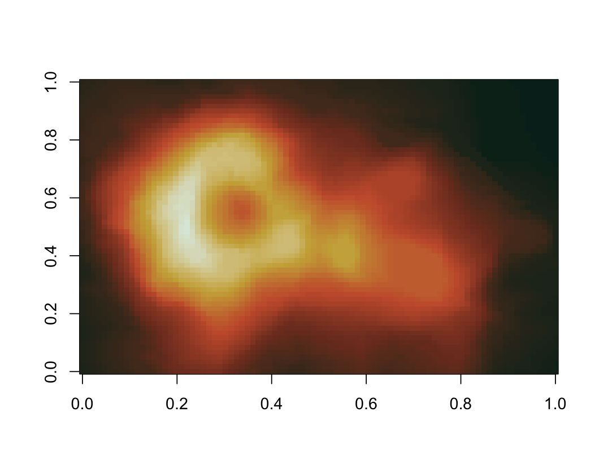
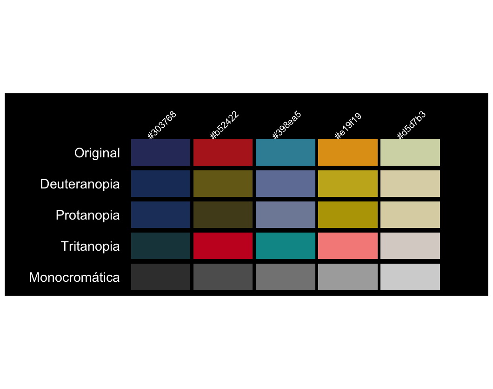
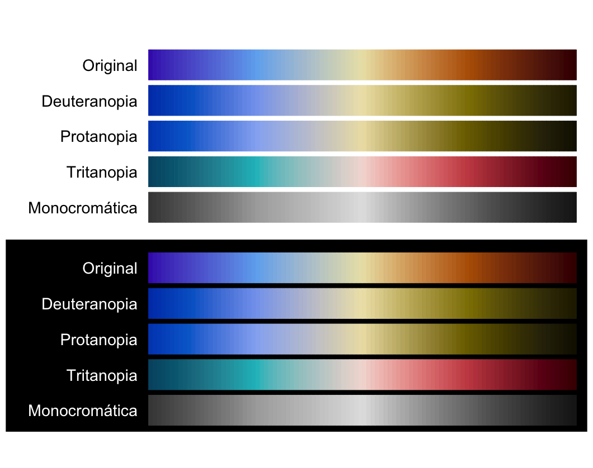

<h1 align="center"><strong>&#123; Tlapalli &#125;</strong></h1>

<p align="center"><em>In tlilli, in tlapalli</em> </p>

Available in: [](https://github.com/mariameraz/tlapalli/blob/main/README.md)

<br>



<p align="justify">
<br>
Paletas de colores para R inspiradas en elementos de la cultura mexicana y mesoamericana. Este es un proyecto personal y pequeño, por lo que por ahora solo se puede instalar desde GitHub. El paquete cuenta actualmente con 27 paletas, disponibles tanto en escalas discretas como continuas, y espero seguir añadiendo más en un futuro. ¡Se agradece cualquier sugerencia (҂◡_◡) ᕤ !
</p>

<br clear="left">

## Instalación

``` r
install.packages(c("remotes"))
remotes::install_github("mariameraz/tlapalli")
```

# Paletas

## ☆ Continuas

<p align="center">
  
</p>

## ☆ Discretas

<p align="center">
  
</p>

## Ejemplos

Ejemplos básicos de cómo usar las paletas de colores:

```r
library(tlapalli)
library(ggplot2)

# Ver los nombres de las paletas
names(tlapalli)

# Obtener los colores de una paleta
tlapalli_pal("Ambar")

# Interpolar colores para obtener una paleta de 10 colores
tlapalli_pal("Ambar", n = 10, type = "continuous")
```


```r
# Escala continua en ggplot2
ggplot(faithfuld, aes(waiting, eruptions, fill = density)) +
   geom_tile() +
   scale_fill_tlapalli_c("Atlas2") +
   theme_minimal()
```

<p align="center">
  
</p>


```r
# Escala discreta en ggplot2
ggplot(mpg, aes(class, fill = class)) +
  geom_bar() +
  scale_fill_tlapalli_d("Quetzal") +
  theme_bw()
```
<p align="center">
  
</p>

```r
# Paleta discreta en R base
barplot(1:6, col = tlapalli_pal("PacificoSuave"))
```
<p align="center">
  
</p>

```r
# Paleta continua en R base
image(volcano, col = tlapalli_pal("Ambar", n = 100, type = "continuous"))
```
<p align="center">
  
</p>

```r
# Mostrar paletas de colores en fondo negro
tlapalli_show("Venado8", background = "black")
```
<p align="center">
  
</p>

```r
tlapalli_show("Altata", n = 100, type = "continuous", background = "both")
```

<p align="center">
  
</p>
