# Gallery

Colors, color vision simulations, and inspiration for each palette are
here.

*We tried to stay close to the original inspiration, but sometimes the
tones differ a bit, because we played with brightness and intensity to
help the palettes work better under different viewing conditions.*

## Alicante

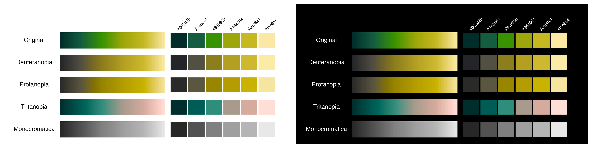

Photo: Saúl Guerrero / [Transvolcanic Alligator Lizard (*Barisia
imbricata*), iNaturalist](https://www.inaturalist.org/photos/25905802)

## Altata

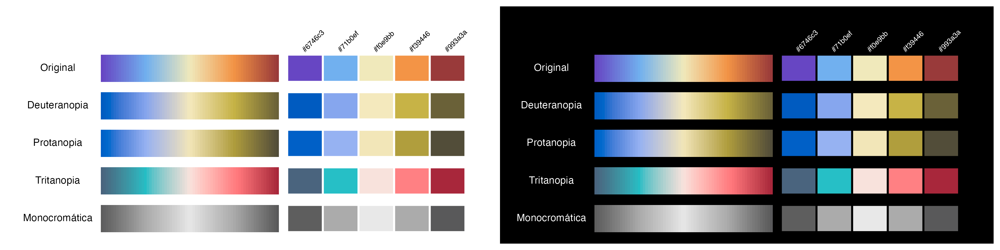

Photo: Miguel Angel Victoria / [Sinaloa
360](https://www.sinaloa360.com/discovering-altata-a-virtual-walk-through-this-coastal-paradise/)

## Ambar

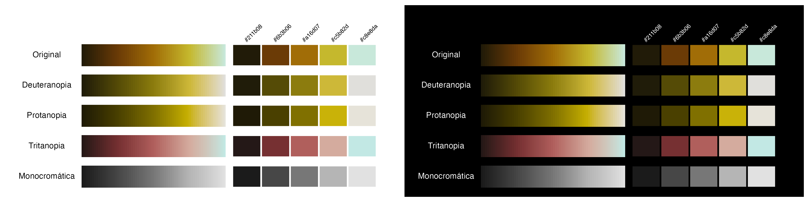

Photo: Museo del Ámbar: San Cristobal de Las Casas / [México
Real](https://mr.travelbymexico.com/5062-museo-del-ambar/)

## Atlas

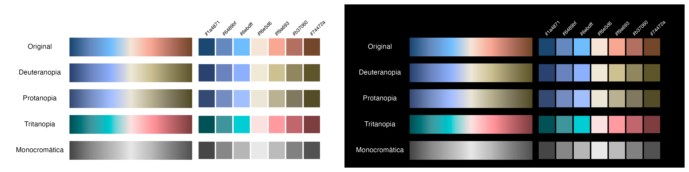

Photo: Atlas de México Grado 4° Generación 1993 / [Secretaría de
Educación Pública; Illustration: Rufino
Tamayo](https://historico.conaliteg.gob.mx/H1993P4GE197.htm)

## Azulillo

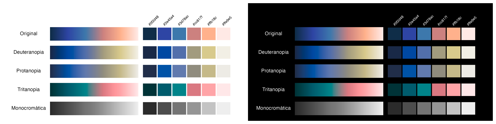

Photo: Dubi Saphiro / [Azulillo ventrirrosado *(Passerina rositae)*,
eBird](https://historico.conaliteg.gob.mx/H1993P4GE197.htm)

## CartaBlanca

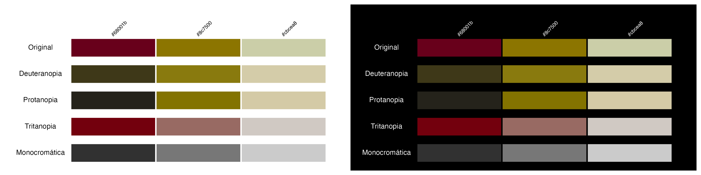

Photo: [Cervecería Carta Blanca](https://www.cartablanca.com.mx/)

## Cempasuchil

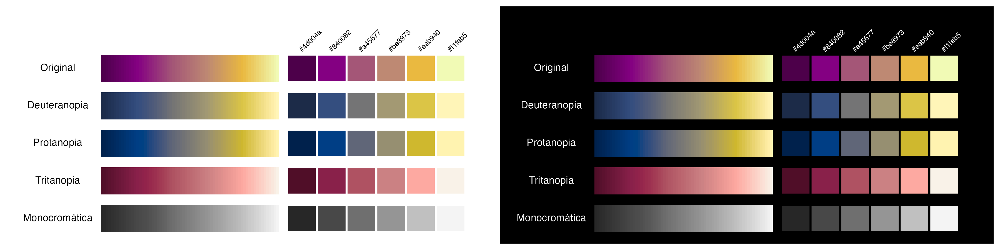

Photo: Fernando Paleta / [“Conociendo a cempasúchil, la flor del Día de
los Muertos”, Ladera
Sur](https://laderasur.com/articulo/mexico-conociendo-a-cempasuchil-la-flor-del-dia-de-los-muertos/)

## Coqueta

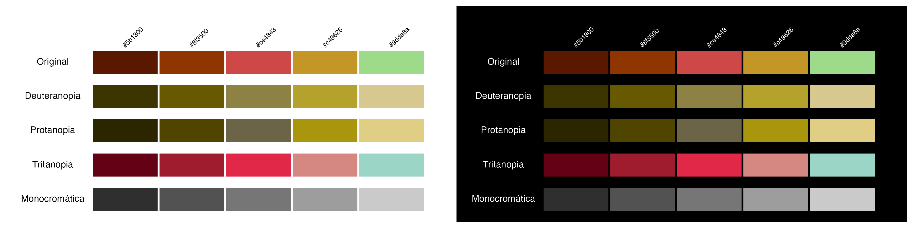

Photo: Anthony Lujan, Short-crested Coquette male / [Coqueta de cresta
corta (*Lophornis brachylophus*), American Bird
Conservancy](https://abcbirds.org/birds/resplendent-quetzal/)

## Conchas

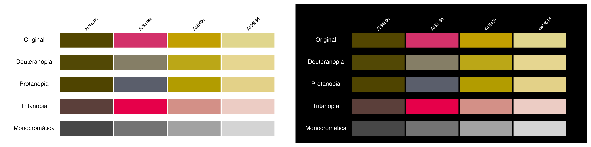

Photo: Maricruz Ávalos F. / [“Conchas Pan Dulce”, Maricruz
Ávalos](https://www.maricruzavalos.com/conchas-pan-dulce/)

## Culiacan

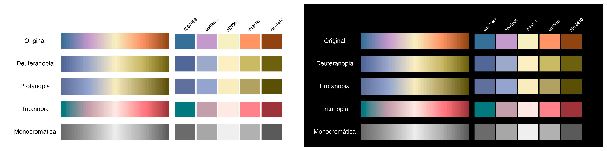

Photo: Atardecer en Sinaloa, [Gobierno del
Estado](https://www.instagram.com/p/C2LYgZURa1d/)

## DiaDeMuertos

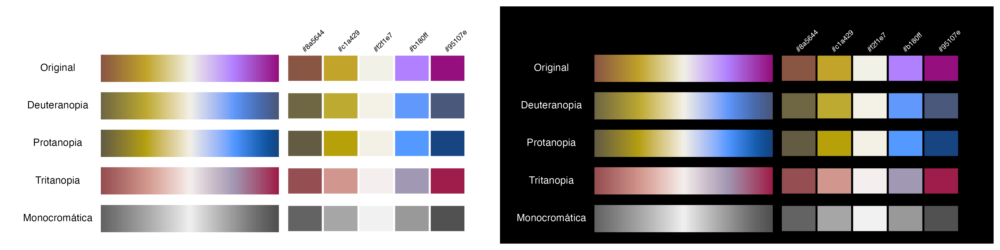

Photo: Chris Luengas / [“Conociendo a cempasúchil, la flor del Día de
los Muertos”, Ladera
Sur](https://laderasur.com/articulo/mexico-conociendo-a-cempasuchil-la-flor-del-dia-de-los-muertos/)

## Jade

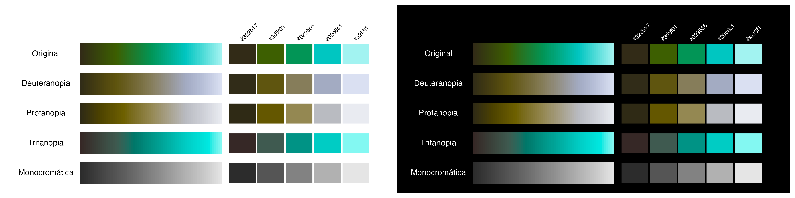

Máscara de murciélago y placa de jade / [Arqueología
Mexicana](https://arqueologiamexicana.mx/mexico-antiguo/el-jade)

## LosTemerarios

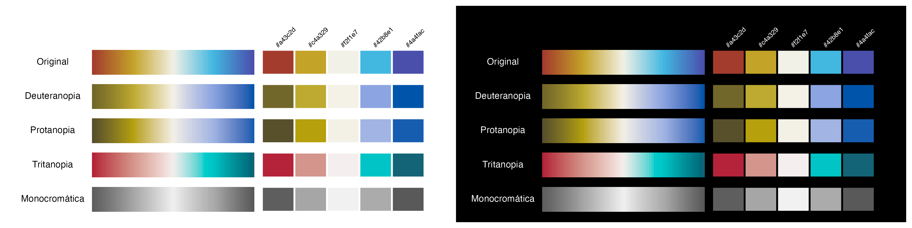

Los Temerarios logo / Adolfo Ángel Alba, 1983

## LosTemerarios2

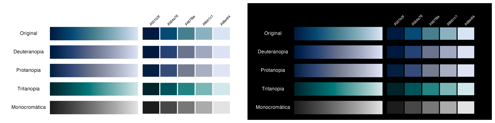

Album cover: *Tu Última Canción*, Los Temerarios (Disa, 1993)

## Momoto

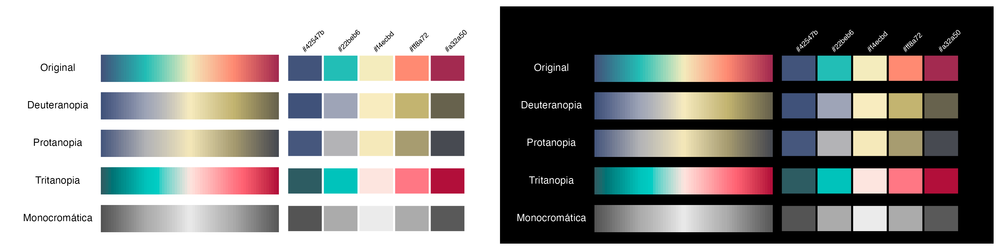

Photo: Alan Van Norman / [Momoto Mexicano (*Momotus mexicanus*),
eBird](https://ebird.org/species/rucmot1?continue)

## Obsidiana

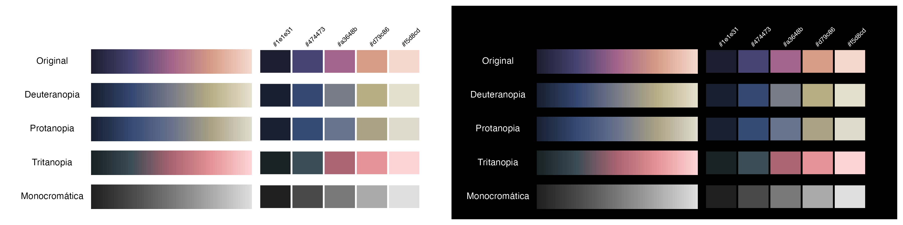

Los colores de la obsidiana en Mesoamérica / [Arqueología
Mexicana](https://arqueologiamexicana.mx/mexico-antiguo/los-colores-de-la-obsidiana-en-mesoamerica)

## Ofrenda

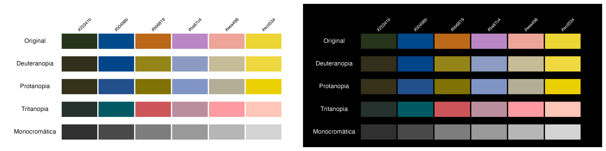

La ofrenda / Saturnino Herrán, 1913. [Museo Nacional de
Arte](https://commons.wikimedia.org/wiki/File:Saturnino_Herr%C3%A1n_-_The_offering_-_Google_Art_Project.jpg),
Public domain, via Wikimedia Commons

## PacificoClara

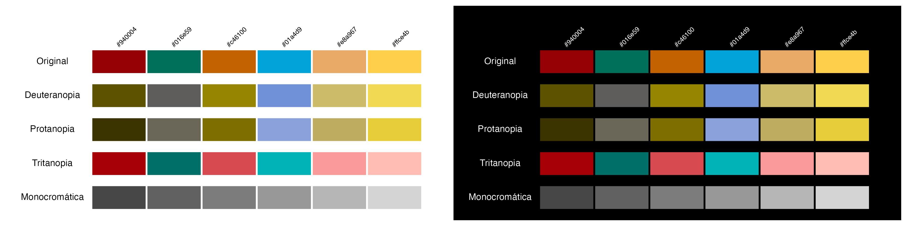

Cerveza Pacífico Clara /
[Kjetil2006](https://commons.wikimedia.org/wiki/File:Cerveza_Pacifico.jpg),
Public domain, via Wikimedia Commons

## PacificoLight

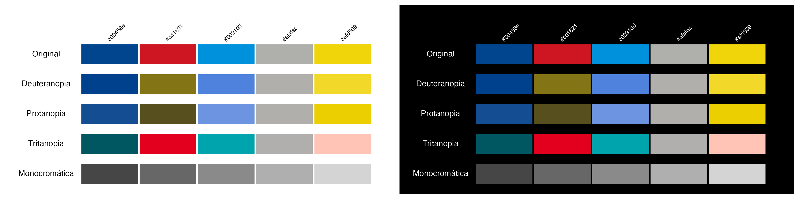

Cerveza Pacífico Light by Cervecería Pacífico

## PacificoSuave

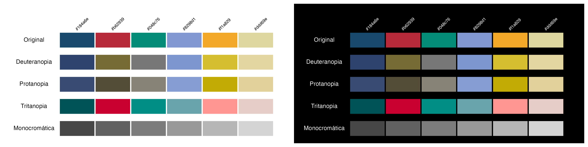

Cerveza Pacífico Suave by Cervecería Pacífico

## Quetzal

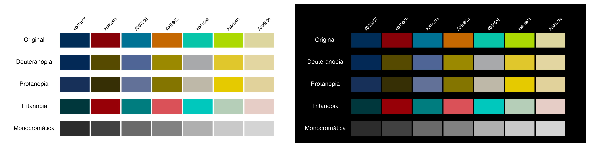

Photo: Ondrej Prosicky, Shutterstock / [Resplendent Quetzals, American
Bird Conservancy](https://abcbirds.org/birds/resplendent-quetzal/)

## Tecate

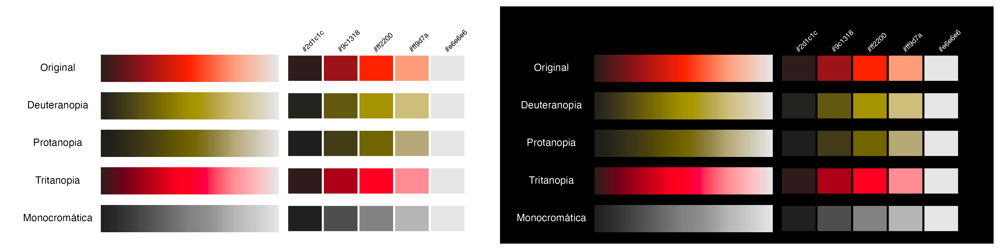

Cerveza Tecate Original by Cervecería Tecate

## Valle

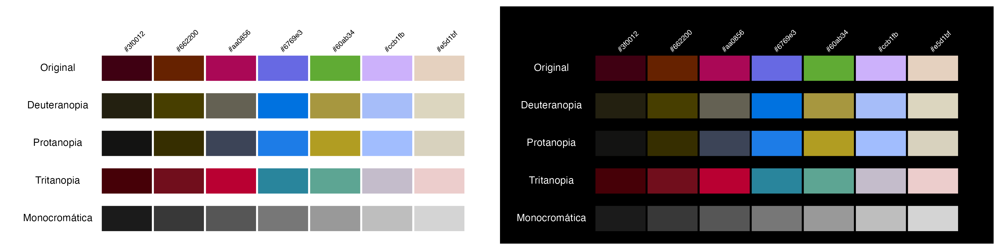

El valle de México / [José María
Velasco](https://www.imer.mx/micrositios/jose-maria-velasco/)

## Venado8

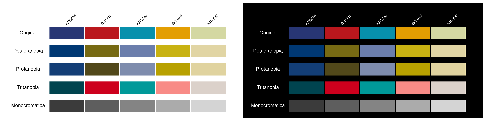

Primeras guerras de 8 Venado en el año 1071 / [Códice Nutall, lám. 43,
Antropología
Mexicana](https://arqueologiamexicana.mx/mexico-antiguo/la-ninez-y-la-juventud-de-8-venado)
